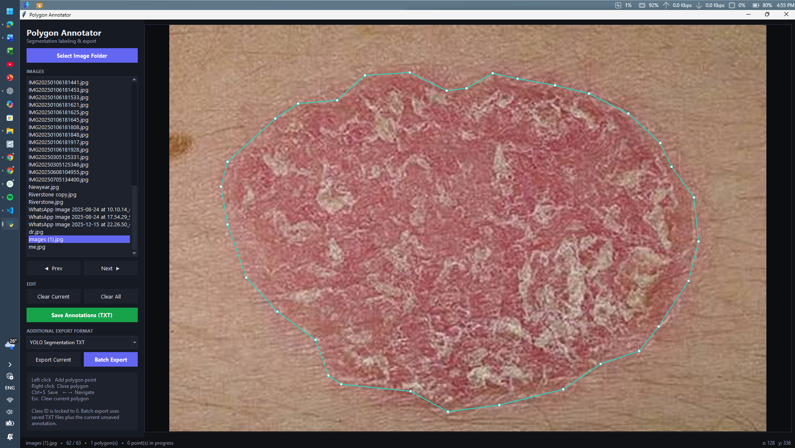

# Polygon Annotation Tool

A Python desktop application for creating polygon annotations on images and exporting segmentation datasets in multiple formats.

The tool is designed for computer vision, image segmentation, and object detection projects, including pothole and road-damage analysis.

## Features

* Interactive polygon annotation using mouse clicks.
* Support for loading image folders.
* Navigation between images.
* Loading and editing existing YOLO segmentation TXT annotations.
* Clearing individual or all polygon annotations.
* Exporting annotations for individual images.
* Batch export for entire image folders.
* Automatic conversion between displayed image coordinates and original image coordinates.

## Supported Export Formats

| Format              | Extension | Purpose                                |
| ------------------- | --------- | -------------------------------------- |
| YOLO Segmentation   | `.txt`    | Normalized polygon coordinates         |
| Binary PNG Masks    | `.png`    | Binary segmentation masks              |
| Grayscale PNG Masks | `.png`    | Single-channel segmentation masks      |
| COCO Segmentation   | `.json`   | COCO-style polygon annotations         |
| LabelMe             | `.json`   | LabelMe-compatible polygon annotations |
| Polygon Coordinates | `.json`   | Polygon coordinates in pixels          |
| Pascal VOC          | `.xml`    | Object bounding boxes                  |

## Requirements

* Python 3.10 or newer
* Pillow
* Tkinter

## Installation

Clone the repository:

```bash
git clone https://github.com/YOUR-USERNAME/Polygon-Annotation-Tool.git
```

Enter the project directory:

```bash
cd Polygon-Annotation-Tool
```

Install the dependency:

```bash
pip install -r requirements.txt
```

## Running the Application

Run the following command:

```bash
python annotator.py
```

## How to Use

1. Launch the application.
2. Select the folder containing your images.
3. Select an image from the image list.
4. Left-click to add polygon vertices.
5. Right-click to close a polygon.
6. Save the annotations in YOLO segmentation TXT format or select another export format.
7. Use the batch export option to export annotations for the image folder.

## Export Directory

Additional export formats are saved in separate directories to keep the generated files organized.

Examples include:

* `export_binary_masks/`
* `export_grayscale_masks/`
* `export_coco/`
* `export_labelme/`
* `export_polygon_json/`
* `export_voc_xml/`

## Applications

This tool can support dataset preparation for:

* Pothole detection and segmentation.
* Road-surface damage analysis.
* Semantic segmentation.
* Computer vision research.
* Custom image annotation workflows.

## Application Preview



## Contributions

Suggestions, bug reports, and improvements are welcome through GitHub Issues and Pull Requests.

## Licence

See the `LICENSE` file for the terms under which this project may be used and distributed.
